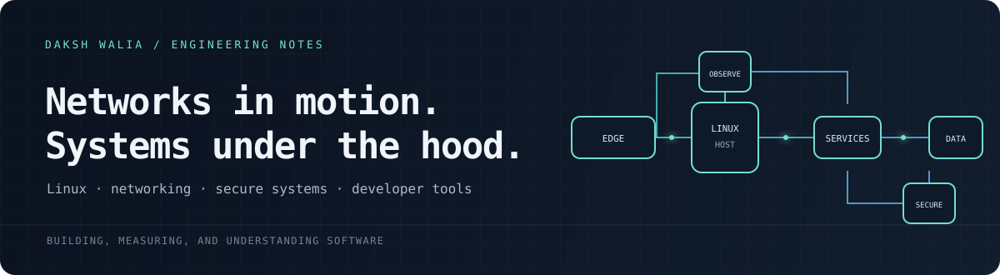

  

  <strong>Systems &amp; network engineering</strong> · Linux · security · developer infrastructure
   
  <a href="mailto:ishandaksh1000@gmail.com">Email</a> ·
  <a href="https://www.linkedin.com/in/daksh-walia-107748308/">LinkedIn</a> ·
  <a href="https://github.com/patchyevolve">GitHub</a> ·
  <a href="https://sysportfolio.netlify.app/">Systems portfolio</a>

---

## Engineering focus

I work across the layers where software meets the machine: process and memory behavior, network-facing services, secure data paths, and the tools used to inspect complex code. The projects below are prototypes, research work, and practical builds; links lead to their source and project notes.

### Network security &amp; secure systems

| Project | What’s inside |
|---|---|
| [AI-IDS-pipeline](https://github.com/patchyevolve/AI-IDS-pipeline) | Network intrusion-detection research: CNN/RNN pipeline, evolving attack/defense components, validation tooling, and an optional C++ backend. |
| [ZT-SDX](https://github.com/patchyevolve/zt_SDX_) | Zero-trust document exchange prototype with a gateway, authentication and policy checks, service boundaries, and audit-oriented workflows. |
| [PQCOMM](https://github.com/patchyevolve/PQCOMM) | Secure communications implementation and architecture work in C. |

### Linux, systems &amp; runtime

| Project | What’s inside |
|---|---|
| [Custom Unix Shell](https://github.com/patchyevolve/codecrafters-shell-cpp) | C++ shell: parsing, processes, pipes, redirection, built-ins, and history. |
| [Systems portfolio](https://github.com/patchyevolve/sys-portfolio) | C projects covering a memory allocator, cryptographic primitives, an RTOS, a VM, an interpreter, and a web server. Includes a live source-backed portfolio. |
| [LIVEWALLIE](https://github.com/patchyevolve/LIVEWALLIE) | GNOME Shell extension and Rust sampler connecting CPU, temperature, GPU, battery, memory, and audio signals to a live desktop visual. |
| [Reactive Keychain Buddy](https://github.com/patchyevolve/reactiveBUDDY) | ESP32-C3 firmware, Android companion, and Go service; Bluetooth LE and offline-first device behavior. |

### Engineering tools &amp; applied systems

| Project | What’s inside |
|---|---|
| [mapit](https://github.com/patchyevolve/mapit) | Rust and tree-sitter code mapper that builds symbol, call, and dependency graphs, with terminal and browser interfaces. |
| [CrimeNet](https://github.com/patchyevolve/crimenet-system) | Explainable link-analysis platform with human-reviewed suggestions, audit trails, and tamper-evident records. |
| [SIM-freak](https://github.com/patchyevolve/SIM-freak) | C++20 N-body simulation with Barnes–Hut gravity, stellar evolution, GPU compute, and OpenGL rendering. |
| [SprintBridge](https://github.com/patchyevolve/SprintBridge) | Full-stack React/TypeScript and FastAPI application with PostgreSQL, evidence-based matching, and browser/backend tests. |

## Languages &amp; tools

**Languages**  
C · C++ · Rust · Python · TypeScript · JavaScript · Kotlin · Go

**Frameworks, platforms &amp; infrastructure**  
Linux · React · FastAPI · Flask · Go/Gin · Android / Jetpack Compose · ESP-IDF · PostgreSQL · SQLite · tree-sitter · CMake · Cargo

---

Selected work is linked to its source so you can inspect the implementation and project scope directly.
