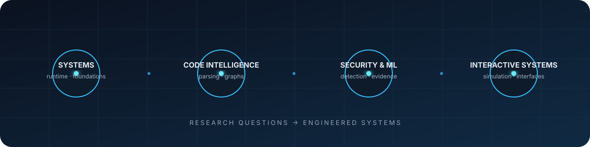

**I study how software behaves beneath the interface, then build tools and products around what I learn.**

[GitHub](https://github.com/patchyevolve) · [Email](mailto:ishandaksh1000@gmail.com) · [LinkedIn](https://www.linkedin.com/in/daksh-walia-107748308/)

## Research & engineering

**Systems and software foundations**  
Processes, runtimes, operating-system concepts, and low-level programming. Explored through a C++ shell, systems examples, and kernel experiments.

**Code intelligence**  
Parsing source code into symbol, call, and reference graphs, then making that structure explorable. [mapit](https://github.com/patchyevolve/mapit) · Rust · tree-sitter

**Security and applied ML**  
Intrusion-detection pipelines, secure document exchange, and evidence-led analysis. Current work is prototype and research code. [AI-IDS](https://github.com/patchyevolve/AI-IDS-pipeline) · [ZT-SDX](https://github.com/patchyevolve/zt_SDX_) · [CrimeNet](https://github.com/patchyevolve/crimenet-system)

**Simulation and interactive systems**  
Numerical models, telemetry, and interfaces that respond to changing state. [simSUS](https://github.com/patchyevolve/simSUS) · [LIVEWALLIE](https://github.com/patchyevolve/LIVEWALLIE) · [Reactive Keychain Buddy](https://github.com/patchyevolve/reactiveBUDDY)

## Languages & tools

**Languages:** C · C++ · Rust · Python · TypeScript · JavaScript · Kotlin · Go

**Tools:** Linux · React · FastAPI · Flask · PostgreSQL · SQLite · tree-sitter · CMake · Cargo

## Selected work

| Project | What it explores |
| :--- | :--- |
| [mapit](https://github.com/patchyevolve/mapit) | Source parsing, code graphs, and developer tooling |
| [SprintBridge](https://github.com/patchyevolve/sprintbridge) | Evidence-based skill profiles and opportunity matching |
| [Custom Unix Shell](https://github.com/patchyevolve/codecrafters-shell-cpp) | Command parsing, processes, pipelines, and redirection |
| [LIVEWALLIE](https://github.com/patchyevolve/LIVEWALLIE) | Linux desktop telemetry and reactive visualization |
| [AI-IDS-pipeline](https://github.com/patchyevolve/AI-IDS-pipeline) | Intrusion detection, model components, and evaluation tools |
| [simSUS](https://github.com/patchyevolve/simSUS) | N-body gravity and interactive numerical simulation |

<b>Other projects</b>

- [Systems Portfolio](https://github.com/patchyevolve/sys-portfolio) — interactive source viewer with C systems examples.
- [ExpenseTracker](https://github.com/patchyevolve/ExpenseTracker) — Android and home-server ledger with SMS parsing and statement reconciliation.
- [Reactive Keychain Buddy](https://github.com/patchyevolve/reactiveBUDDY) — ESP32 firmware, Android app, and Go backend.
- [CheckOutRadar](https://github.com/patchyevolve/CheckOutRadar) — checkout-flow evidence capture and comparison.
- [Forge](https://github.com/patchyevolve/forge-backend-ENVIORNMENT) — Rust plugin runtime with HTTP/gRPC gateway.

Research questions → working software → clear evidence

